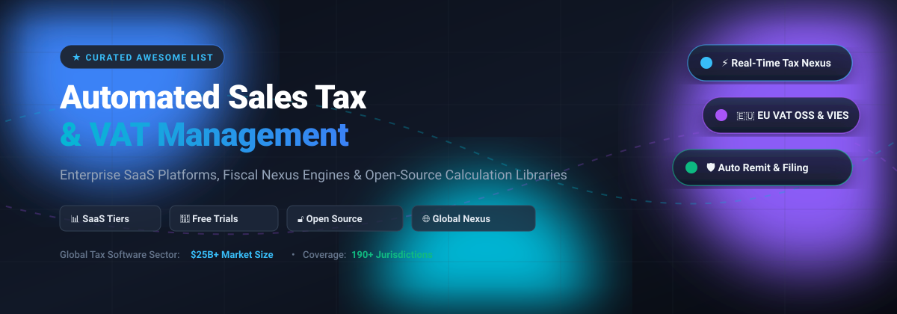

# 🧾 Awesome Automated Sales Tax & VAT Management

  <strong>A production-ready curated index of automated sales tax engines, VAT compliance platforms, economic nexus monitors, and open-source tax calculation libraries.</strong>

  
  
  
  
  
  

---

## 📌 Table of Contents
- [📈 Sector Overview & Market Dynamics](#-sector-overview--market-dynamics)
- [🏢 Enterprise & SaaS Sales Tax & VAT Platforms](#-enterprise--saas-sales-tax--vat-platforms)
- [🔓 Open-Source Tax Calculation Libraries](#-open-source-tax-calculation-libraries)
- [🛠️ Key Features to Evaluate](#️-key-features-to-evaluate)
- [🤝 Contributing](#-contributing)
- [💖 Support](#-support)
- [📊 Star History](#-star-history)

---

## 📈 Sector Overview & Market Dynamics

The global tax automation and indirect tax compliance software market is valued at approximately **$22 billion to $28 billion**, and is projected to surpass **$50 billion by the early 2030s** with a compound annual growth rate (CAGR) of 10%–12%. 

The sector is **moderately fragmented overall** due to distinct localized rules, continuous transaction controls (CTC), electronic invoicing (e-invoicing) mandates, and disparate cross-border tax regimes (such as US State Sales Tax, EU VAT One-Stop Shop (OSS), and Canadian GST/HST/PST). However, the ecosystem exhibits **high concentration at the top tier**, where a handful of multi-billion-dollar enterprise platforms and payment giants dominate multinational corporate filings and high-volume digital merchant checkout flows.

---

## 🏢 Enterprise & SaaS Sales Tax & VAT Platforms

The following table benchmarks leading indirect tax SaaS providers, sorted in descending order by enterprise valuation and scale.

| Company / Product | Company Size (Valuation / Revenue) | Starting Pricing (Specific Tier) | Free Tier / Trial Limits | Details & Capabilities |
|---|---|---|---|---|
| **Stripe Tax** (includes **TaxJar**) | **$159B valuation** (~$6.8B net revenue; TaxJar acquired for ~$850M–$900M) | **$90/month** (Tax Complete starter plan for 200 transactions/mo & 2 registrations/yr) or **0.50% / $0.50 per transaction** (Tax Basic pay-as-you-go where registered) | **TaxJar:** 30-day free trial (no credit card required, full feature testing during trial); **Stripe Tax:** Free sales monitoring and obligation alert tracking across jurisdictions until threshold registration is triggered | Automated real-time rate calculations, economic nexus threshold tracking, and multi-state/multi-country filing assistance across 50+ countries. |
| **Thomson Reuters ONESOURCE** | **$53B market cap** (~$8B TTM revenue) | **$12,000/year** (custom entry tier for standard ERP determination modules via AWS Marketplace / direct licensing) | **No free tier**; 30-day sales-assisted POC sandbox for qualified corporate accounts upon evaluation request | Multinational indirect tax engine designed for large enterprises, supporting complex supply-chain rules, ERPs (SAP, Oracle), and global VAT/GST. |
| **Avalara (AvaTax)** | **$8.4B valuation** (Acquired by Vista Equity Partners in 2022) | **$69/state/month** (SST Services tier) or **$79/state/month** (Core Compliance tier, annual billing, 3-state minimum) | **90-day free trial** (AvaTax developer evaluation sandbox with up to 500 calculation calls) | 1,400+ pre-built connectors, real-time rates covering 13,000+ US taxing jurisdictions, cross-border customs/VAT, and automated returns remittance. |
| **Chargebee Tax** | **$3.5B valuation** (Series H funding) | **$0/month** (Starter tier up to $250k cumulative lifetime billing; then 0.75% overage) or **$599/month** (Performance tier billed annually for up to $100k/mo MRR) | **Free forever plan** up to $250,000 cumulative lifetime billing; paid plans include a **14-day free trial** with full feature access | Purpose-built subscription billing tax suite with dynamic region-based rules and direct Avalara/Vertex integrations. |
| **Sovos Compliance** | **$2.5B–$3.0B valuation** (~$400M+ revenue; backed by Hg & TA Associates) | **$10,000/year** (Small/Mid tier starting contract for basic single-module determination <50k transactions) | **No free tier** for enterprise engines; **7-day free trial** available specifically for *Sovos ReportMyUP* product (credit card required) | Deep expertise in e-invoicing mandates, continuous transaction control (CTC), global VAT determination, and statutory compliance. |
| **Vertex, Inc.** (includes **Taxamo**) | **$2.5B market cap** (~$650M revenue; acquired Taxamo for $200M in 2021) | **$8,500/year** (~$708/month entry-level subscription for small-scale cloud connectors; standard median enterprise deployment at ~$33,000/year) | **No free tier**; guided sandbox testing and custom proof-of-concept environment available upon vendor sales demo approval | Enterprise tax compliance platform covering corporate procurement, indirect sales tax, and cross-border digital VAT/GST (Taxamo Assure). |
| **Anrok** | **$525M valuation** (Series C funding) | **$100/market/month** (Starter tier; each US state, EU OSS, or country counted as an active market) | **No permanent free tier**; pre-sale custom sandbox environment provided during onboarding evaluation upon demo request | Built specifically for modern SaaS and digital product companies; integrates natively with billing gateways and corporate ERPs. |
| **Quaderno** | Bootstrapped / Acquired by Visma (~$3M ARR) | **€29/month** (Hobby plan, includes up to 25 transactions/month; next tier is €49/month for up to 100 transactions) | **7-day free trial** (Includes full sandbox testing access to tax calculation, invoicing, and threshold notifications) | Automated fiscal receipts, real-time nexus monitoring, and worldwide tax calculation tailored for digital creators and e-commerce. |

---

## 🔓 Open-Source Tax Calculation Libraries

A curated collection of production-tested open-source libraries for self-hosted tax calculation, VAT validation, and economic nexus logic. Sorted by GitHub Stars_Count (descending).

| Project & Repo | GitHub_Stars | Language | Capabilities & Scope |
|---|---|---|---|
| **[laravel/vat-calculator](https://github.com/laravel/vat-calculator)** |  | PHP | Full-featured EU VAT / MOSS calculation engine with geolocation lookup and VAT rate tables. |
| **[valeriansaliou/node-sales-tax](https://github.com/valeriansaliou/node-sales-tax)** |  | TypeScript / Node.js | International sales tax and VAT calculator for Node.js with offline tax rates and VAT fraud checks. |
| **[yolk/valvat](https://github.com/yolk/valvat)** |  | Ruby | Validates European VAT numbers with official VIES check, syntax validation, and ActiveModel support. |
| **[DragonBe/vies](https://github.com/DragonBe/vies)** |  | PHP | Robust PHP client to verify and validate EU VAT registration numbers via the European Commission VIES API. |
| **[pH-7/eu-vat-validator](https://github.com/pH-7/eu-vat-validator)** |  | PHP | Lightweight, standalone library that validates EU VAT numbers against the central ec.europa.eu service. |
| **[codingjoe/django-vies](https://github.com/codingjoe/django-vies)** |  | Python / Django | European VIES VAT number model field and form validator for Django applications. |
| **[gitterHQ/vat-calculator](https://github.com/gitterHQ/vat-calculator)** |  | JavaScript | Client-side and server-side calculation library for European VAT rates across digital goods. |
| **[ejosterberg/open-sales-tax](https://github.com/ejosterberg/open-sales-tax)** |  | PHP / Python | Open-source US sales tax calculation engine with API connectors for Odoo, Saleor, and Drupal Commerce. |

---

## 🛠️ Key Features to Evaluate

When selecting an automated sales tax or VAT solution, consider these core technical requirements:

1. 📍 **Rooftop-Level Geolocation**: Ensuring tax calculations reflect precise latitude/longitude boundaries rather than imprecise 5-digit ZIP codes.
2. 🚨 **Economic Nexus Tracking**: Monitoring gross revenue and transaction count thresholds across individual US states and countries.
3. 🇪🇺 **EU VAT One-Stop Shop (OSS)**: Handling reverse-charge VAT for B2B transactions and domestic rates for B2C cross-border sales.
4. 🧾 **E-Invoicing & CTC Mandates**: Supporting real-time reporting formats (e.g., Peppol, Factur-X, KSeF, FatturaPA).
5. 🔄 **Automated Remittance & Filing**: Providing direct automated ACH filing and preparation of tax returns to jurisdictional authorities.

---

## 🤝 Contributing

Contributions are warmly welcomed! Please read our guidelines before submitting:

- To add a new SaaS platform, ensure you include **specific starting tier pricing**, **free tier/trial limits**, and **company valuation or revenue metrics**.
- To add an open-source library, ensure the repository is active, tested, and relevant to sales tax or VAT calculation.
- Submit pull requests directly to `main`.

---

## 💖 Support

If you found this curated list helpful for your fintech infrastructure, tax research, or engineering stack, please consider supporting the project:

- ⭐ **Star** this repository to help others discover it!
- 🍴 **Fork** the repo and contribute your insights or tools.
- 📢 **Share** this resource with your fellow developers, CFOs, and finance engineers.
- ☕ **Sponsor & Buy a Coffee**: Support ongoing maintenance via the [GitHub Sponsors Dashboard](https://github.com/sponsors/ishandutta2007).

---

##  Star History

